# Documentação de entrega — local_companycourse

Plugin local para Moodle 5 / IOMAD 5 que replica um curso base para uma ou mais Companies via Backup/Restore nativo.

| Item | Valor |
|------|--------|
| Autor | Wagner Dos Santos Backes |
| E-mail | wagnerbackes@gmail.com |
| Componente | `local_companycourse` |
| Versão | `2026081807` / release `0.7.0` (`MATURITY_BETA`) |
| Ambiente | Moodle 5.0.8 + IOMAD (`IOMAD_500_STABLE`), PHP 8.3, MariaDB 11.4 |
| Repositório | https://github.com/wagnerbackes/local_companycourse |
| Capability | `local/companycourse:manage` |

## Como subir o ambiente

```bash
git clone https://github.com/wagnerbackes/local_companycourse.git .
./setup.sh
```

- URL: http://localhost:8088  
- Admin: `admin` / `Admin123!`  

Detalhes do stack: [README da raiz](../../../../README.md).

## Como usar (passo a passo)

### 1. Confirmar que o plugin está instalado

**Onde:** Administração do site → Plugins → Visão geral dos plugins  
**URL:** `/admin/plugins.php`

Na seção **Plugins locais**, localize **Replicação de cursos para empresas** (`local_companycourse`).

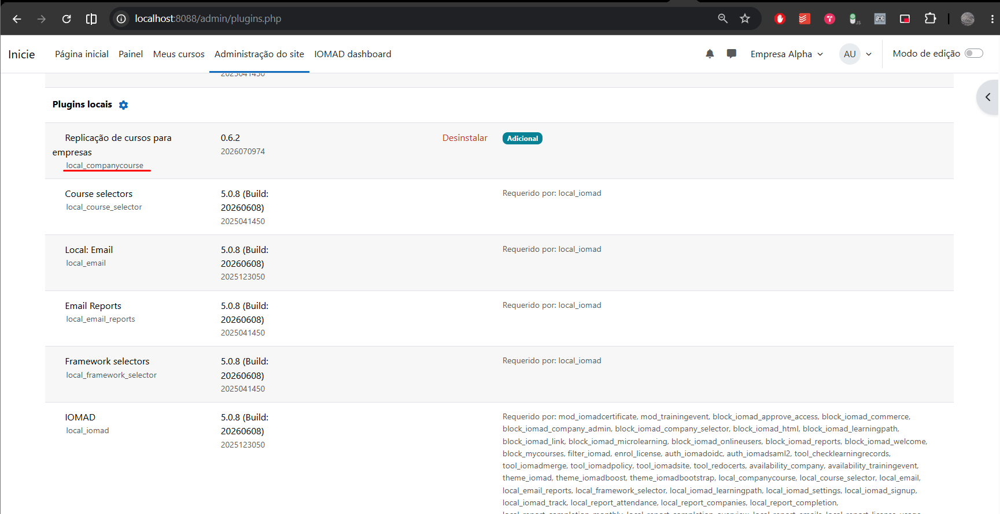

### 2. (Opcional) Inspecionar o schema XMLDB

**Onde:** Administração do site → Desenvolvimento → Editor XMLDB  
**URL:** `/admin/tool/xmldb/`

1. Clique em **[Carregar]** ao lado de `local/companycourse/db`.
2. Abra a tabela `local_companycourse_log` para ver os campos de auditoria.

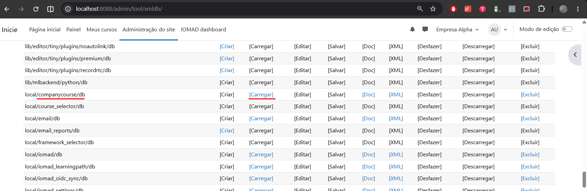

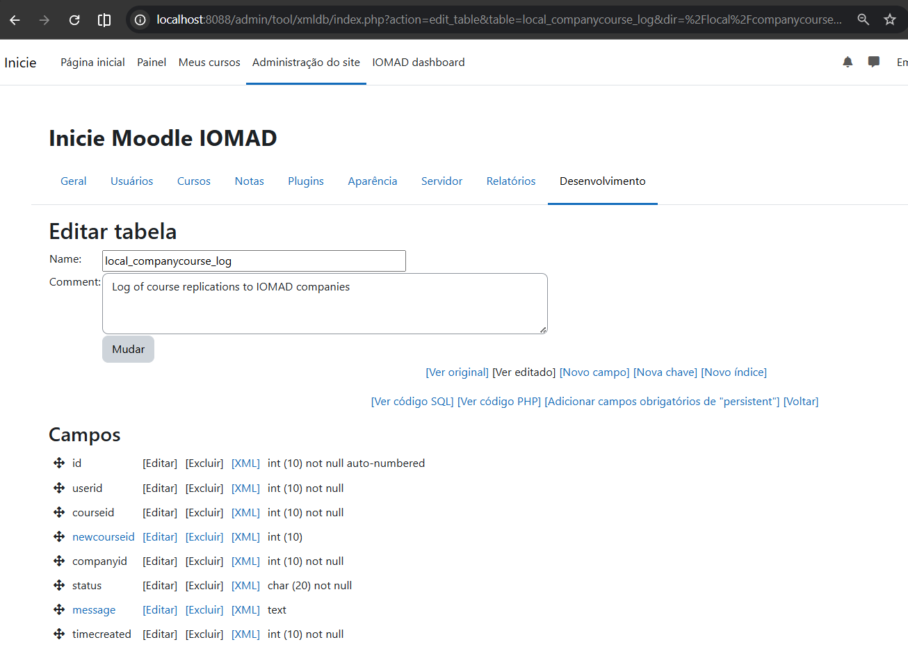

| Campo | Uso |
|-------|-----|
| `userid` | Quem executou a replicação |
| `courseid` | Curso base |
| `newcourseid` | Curso criado (quando houver sucesso) |
| `companyid` | Company IOMAD de destino |
| `status` | `success`, `error`, `skipped`, etc. |
| `message` | Mensagem amigável / detalhe |
| `timecreated` | Data/hora Unix |

### 3. Abrir a tela de replicação

**Caminho principal:** Administração do site → **Cursos** → **Replicar cursos para empresas**  
**URL:** `/local/companycourse/index.php`

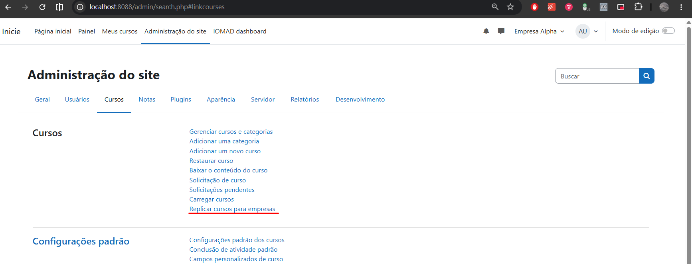

Outras entradas:

| Entrada | URL |
|---------|-----|
| Plugins locais → categoria do plugin | `/admin/category.php?category=local_companycourse` |
| IOMAD dashboard → Courses | `/local/companycourse/index.php?dashboard=1` |

### 4. Preencher o formulário

Na tela do formulário:

1. Leia o aviso: dados de usuários ficam **desativados por padrão** (recomendado para curso-modelo).
2. Em **Curso base**, escolha o curso a copiar.
3. Em **Empresas de destino**, selecione uma ou mais companies.
4. Deixe **Incluir dados de usuários** desmarcado, salvo necessidade explícita.
5. Clique em **Replicar curso**.

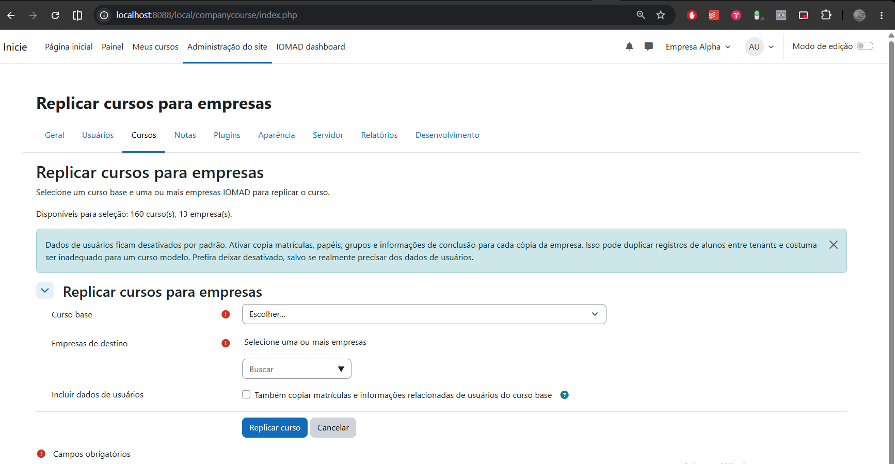

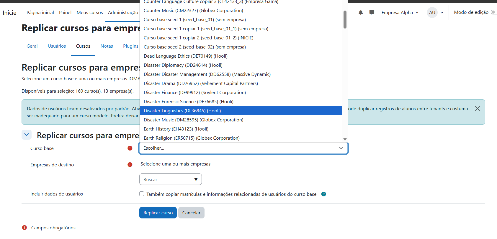

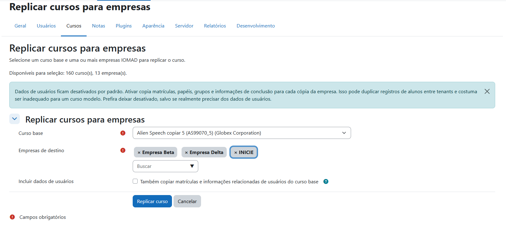

### 5. Conferir o resumo

Após a execução, a página mostra o **Resumo da replicação**: total, sucessos, erros, ignorados e o ID do novo curso por empresa.

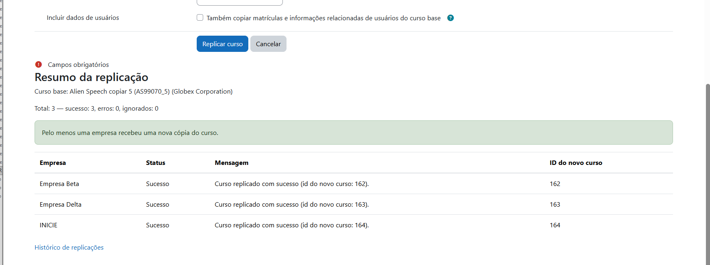

Use o link **Histórico de replicações** no rodapé do resumo (ou o menu abaixo) para auditar depois.

### 6. Consultar o histórico

**Caminho:** Administração do site → **Relatórios** → **Histórico de replicações**  
**URL:** `/local/companycourse/history.php`

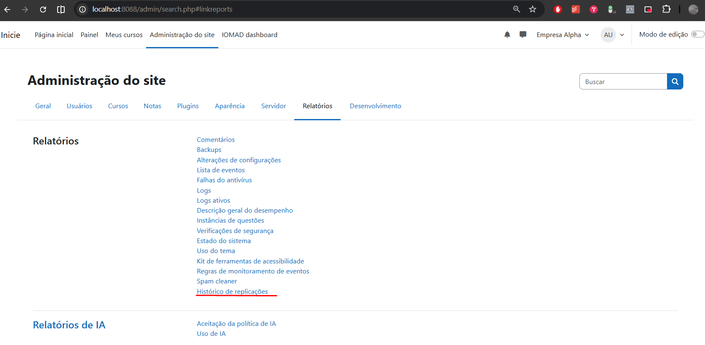

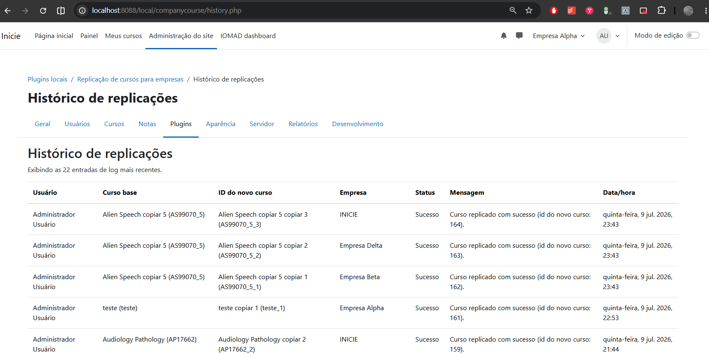

A tabela mostra usuário, curso base, novo curso, empresa, status, mensagem e data/hora.

### 7. Atalhos no painel IOMAD

**IOMAD dashboard → Courses** — ícone **Replicar cursos para empresas** (abre o formulário).

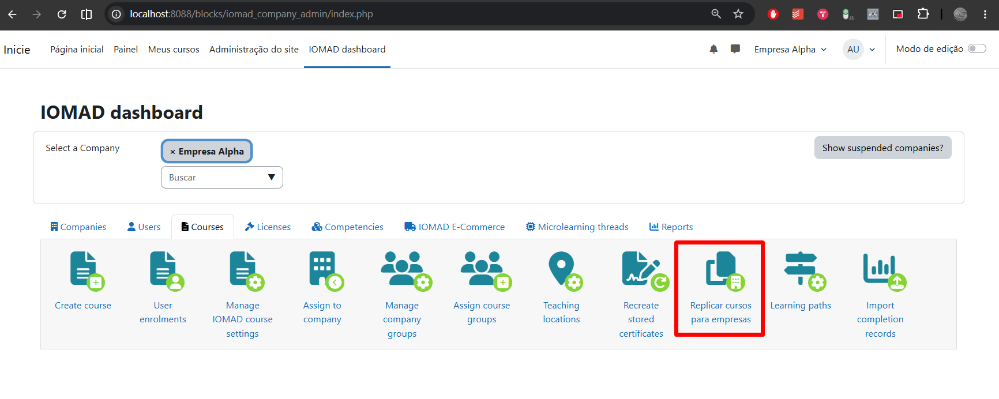

**IOMAD dashboard → Reports** — ícone **Histórico de replicações**.

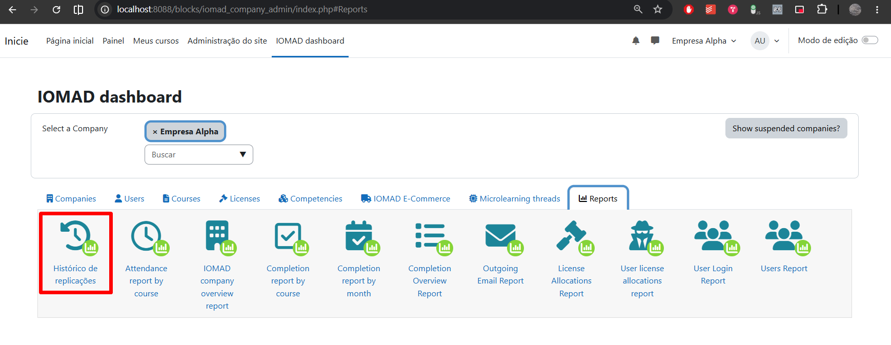

## Mapa das evidências

| Print | O que é | Como usar |
|-------|---------|-----------|
| `Screenshot_1` | Plugin na visão geral | Validar instalação e versão |
| `Screenshot_2` | XMLDB — carregar DB do plugin | Inspecionar `install.xml` |
| `Screenshot_3` | Campos de `local_companycourse_log` | Entender o log de auditoria |
| `Screenshot_4` | Menu Admin → Cursos | Encontrar a entrada principal |
| `Screenshot_5` | Formulário | Iniciar uma replicação |
| `Screenshot_6` | Dropdown de cursos | Escolher o curso base |
| `Screenshot_7` | Seleção completa | Confirmar destino antes de executar |
| `Screenshot_8` | Resumo do lote | Verificar sucesso e IDs novos |
| `Screenshot_9` | Menu Admin → Relatórios | Abrir o histórico |
| `Screenshot_10` | Página de histórico | Auditar operações |
| `Screenshot_11` | IOMAD → Courses | Atalho operacional |
| `Screenshot_12` | IOMAD → Reports | Atalho de auditoria |

## Decisões técnicas

1. **Backup/Restore nativo** — `backup_controller` / `restore_controller`, `MODE_GENERAL` síncrono; 1 `.mbz` + N restores; sem cópia SQL.
2. **Falha de restore** — motivo e detalhe técnico no log e na UI.
3. **Rollback IOMAD** — se a associação falhar após o restore, o curso restaurado é removido.
4. **Usuários** — default OFF (`includeusers`).
5. **Categoria IOMAD** — reutiliza `company.category`; não usa `company::get_category()`.
6. **Associação** — `company::add_course($course, 0, true, false)` → `shared=0`.
7. **Duplicidade** — skip se já existir log `success` para o mesmo `(courseid, companyid)`.
8. **Erros** — falha isolada por empresa.
9. **Logs** — tabela `local_companycourse_log` via `log_service`.
10. **Privacy** — provider completo (metadata, export e delete).

## Roteiro de teste rápido

1. `./setup.sh` → login admin.
2. Confirmar plugin em Plugins overview (`Screenshot_1`).
3. Admin → Cursos → Replicar (`Screenshot_4` / `5`).
4. Selecionar 1 curso + 2 ou mais companies (`Screenshot_6` / `7`) → executar.
5. Ver resumo (`Screenshot_8`).
6. Abrir histórico (`Screenshot_9` / `10`).
7. Repetir o mesmo par → status `skipped`.

## Pendências

Nenhuma. Backup/Restore nativo completo.
