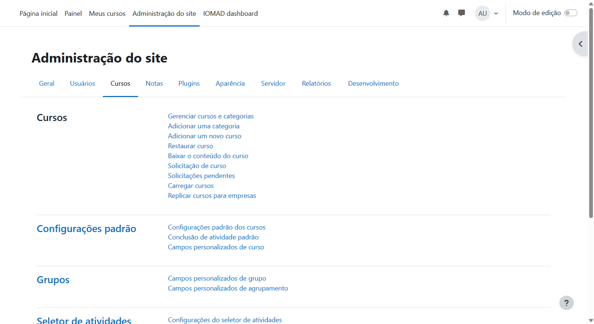
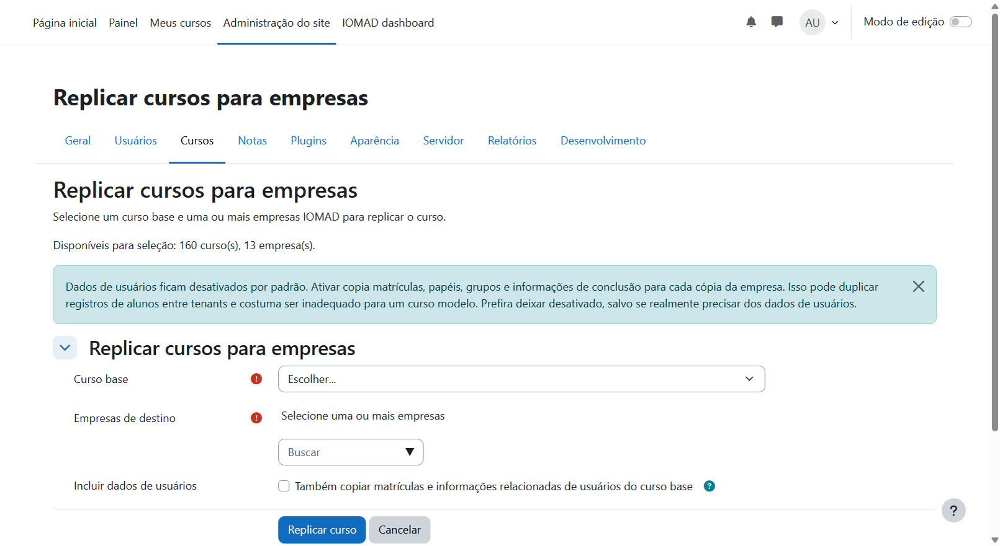
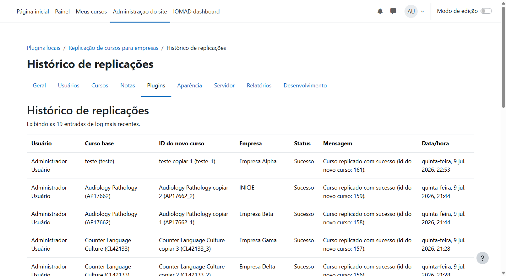
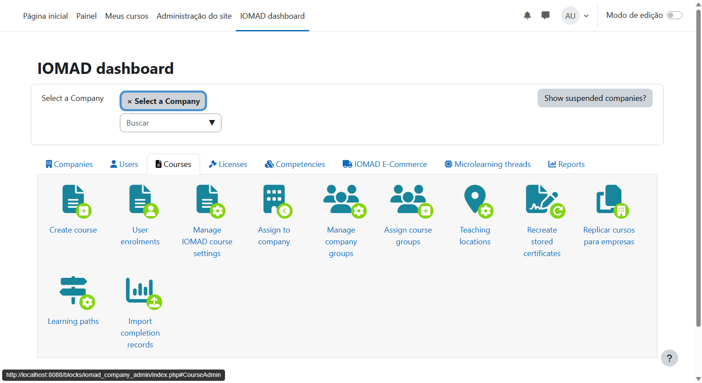
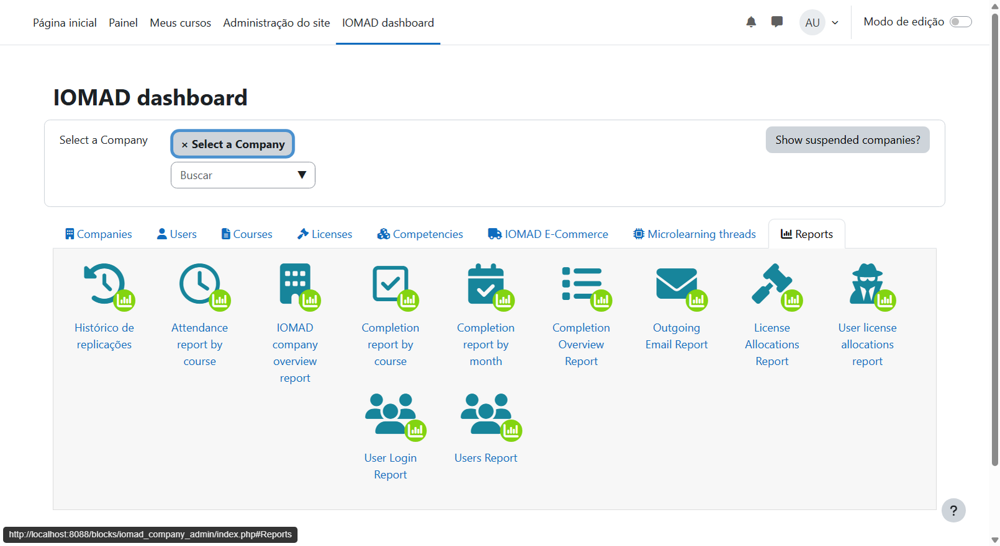

# Documentação de entrega — local_companycourse

Plugin local para Moodle 5 / IOMAD 5 que replica um curso base para uma ou mais Companies via Backup/Restore nativo.

| Item | Valor |
|------|--------|
| Autor | Wagner Dos Santos Backes |
| E-mail | wagnerbackes@gmail.com |
| Componente | `local_companycourse` |
| Versão | `2026070914` / release `0.6.2` (`MATURITY_BETA`) |
| Ambiente | Moodle 5.0.8 + IOMAD (`IOMAD_500_STABLE`), PHP 8.3, MariaDB 11.4 |
| Repositório | https://github.com/wagnerbackes/local_companycourse |

## Entregáveis

| Entregável | Onde |
|------------|------|
| Código do plugin | `moodle/local/companycourse/` |
| Docker / setup | `docker-compose.yml`, `setup.sh`, `docker/`, `scripts/seed.sh` |
| Instalação e uso | [README.md](../../../README.md) (raiz) e [README do plugin](../README.md) |
| Decisões técnicas | esta página |
| Evidências | [prints/](prints/) + roteiro de teste abaixo |

## Como subir o ambiente

```bash
git clone https://github.com/wagnerbackes/local_companycourse.git .
./setup.sh
```

- URL: http://localhost:8088  
- Admin: `admin` / `Admin123!`  
- O `setup.sh` clona o IOMAD, sobe os containers, ajusta permissões de `moodledata` (`www-data`), instala/atualiza o Moodle e executa o seed.

Detalhes: [README da raiz](../../../README.md).

## Acesso ao plugin

Capability: `local/companycourse:manage`.

| Entrada | URL |
|---------|-----|
| Admin → Cursos | `/local/companycourse/index.php` |
| Plugins locais | `/admin/category.php?category=local_companycourse` |
| Histórico (Relatórios) | `/local/companycourse/history.php` |
| IOMAD → Courses | `/local/companycourse/index.php?dashboard=1` |
| IOMAD → Reports | `/local/companycourse/history.php?dashboard=1` |

### Menu Administração → Cursos



### Formulário de replicação



### Histórico



### IOMAD dashboard → Courses



### IOMAD dashboard → Reports



Demais capturas: [prints/](prints/).

## Decisões técnicas

1. **Backup/Restore nativo** — `backup_controller` / `restore_controller`, `MODE_GENERAL` síncrono; 1 `.mbz` + N restores; sem cópia SQL.
2. **Falha de restore** — motivo e detalhe técnico gravados no log e exibidos na UI.
3. **Rollback IOMAD** — se a associação falhar após o restore, o curso restaurado é removido (sem órfão).
4. **Usuários** — default OFF (`includeusers`); curso-modelo.
5. **Categoria IOMAD** — reutiliza `company.category`; cria só se inválida; não usa `company::get_category()` (é user_info).
6. **Associação** — `company::add_course($course, 0, true, false)` → `shared=0`.
7. **Duplicidade** — skip se já existir log `success` para o mesmo `(courseid, companyid)`.
8. **Erros** — falha isolada por empresa; o lote só aborta para curso inválido ou lista vazia.
9. **Logs** — tabela `local_companycourse_log` via `log_service`; índice `(courseid, companyid, status)`.
10. **Privacy** — provider completo (metadata, export e delete) da tabela de log.
11. **Arquitetura** — UI fina + serviços em `classes/service/` (`replication_manager` orquestra validação, backup/restore, IOMAD e logs).

## Roteiro de teste manual

1. `./setup.sh` ou `docker compose up -d` → login admin.
2. Confirmar plugin instalado (Notificações / upgrade).
3. Abrir **Replicar cursos** (Cursos, Plugins locais ou IOMAD Courses).
4. Selecionar 1 curso base + 2 companies → executar (`includeusers` OFF).
5. Ver resumo de sucesso; abrir **Histórico** e conferir 2 linhas.
6. Repetir o mesmo par → status `skipped`.
7. Usuário sem capability → acesso negado.

## Testes automatizados

```bash
docker compose exec -T -u www-data web vendor/bin/phpunit \
  --testsuite local_companycourse_testsuite \
  --configuration phpunit.xml
```

Resultado verificado: **37 testes, 150 assertions, OK**.

## Pendências

Nenhuma. Backup/Restore nativo completo; sem fallback de prazo.
